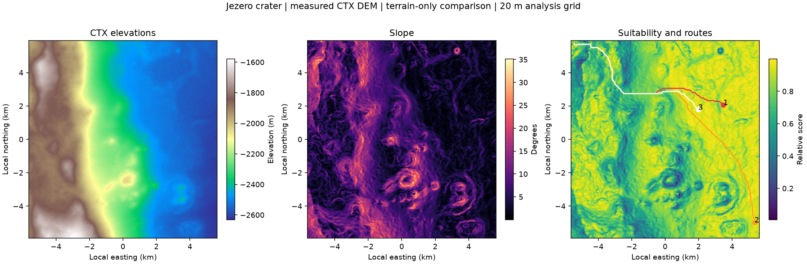

# MarsHab / MarsGIS

**[Open the live MarsHab website](https://marshab.onrender.com)**

MarsHab is a scientific software portfolio project for exploring Mars terrain, selecting two locations, calculating terrain-constrained paths and inspecting them in 3D. It uses a real NASA MOLA global elevation grid for planetary context and regional routing, plus NASA MRO CTX terrain for detailed Jezero traverses.

The emphasis is reproducible geospatial computation: explicit units and coordinate systems, invalid-data masks, analytical tests, independent shortest-path references, and inspectable outputs. Candidate scores illustrate terrain tradeoffs; they do not establish habitat safety.

## Current local acceptance (November 1, 2026)

[Browser and free-tier acceptance](docs/implementation/MH03_BROWSER_ACCEPTANCE_2026-11-01.md) now covers actual map/keyboard routing, WebGL interaction, cancellation/fallback and the full comparison workflow at a bounded 512 MiB / 0.1 CPU profile. Scientific exports remain unchanged by the UI/lifetime fixes. The measured journey completed without OOM, with reclaim pressure; this is not a general headroom guarantee. Full recomputation can take several minutes on that CPU tier. Public deployment must separately match the tested source/build identity.

## Website and API together

The website and API run as **one service**. The default workspace provides a pannable, scroll/zoom Mars map, start/destination selection, calculated routes and a rotatable 3D terrain/path viewer with **1–100× vertical exaggeration**. Use **Jezero example** for a short detailed traverse, or choose locations elsewhere on Mars. The results identify the source and effective analysis spacing; exaggeration changes the display, not measured elevations.

The separate **Site comparison** page preserves the validated DEM-to-suitability example, candidate comparison and original exports. See [map, routing and 3D methods](docs/map-routing.md).

After installing the Python environment below, use Node **22.13+** to build the website:

```powershell
.venv/Scripts/python.exe scripts/prepare_planetary_data.py
cd webui
npm ci
npm run build
cd ..
.venv/Scripts/python.exe -m marshab.web.server
```

The preparation command provisions the checksum-pinned global MOLA source (33 MB) and CTX source (9.7 MB) in the configured cache. No request triggers an unbounded global download. Open `http://localhost:5000`. Alternatively, `docker compose up --build` packages the website, API and both DEMs together. See [deployment and API instructions](docs/unified-deployment.md).

The unified service is live at **https://marshab.onrender.com**. Public HTTP verification on 2026-10-28 completed a fresh real-DEM calculation and checked every exported artifact's checksum. See the [deployment verification record](docs/live-verification.md). Those historical HTTP records predate the now-authorized local browser acceptance linked above; they do not independently identify a newer public deployment.

This uses Render's free compute plan, which sleeps after inactivity and can take about a minute to wake. Open it before a live interview; the verified reference analysis is available after startup. See [Render's free-service behavior](https://render.com/docs/free).



## Reproduce the example

Requirements: Python **3.11**, [uv](https://docs.astral.sh/uv/), internet for the first 9.7 MB DEM download. No credentials, paid APIs, or manual dataset acquisition. Subsequent runs use the checksum-verified local source.

From the repository root, on Windows PowerShell:

```powershell
uv venv --python 3.11 .venv
uv pip install --python .venv/Scripts/python.exe --require-hashes -r requirements-bootstrap.lock -r requirements-dev.lock
uv pip install --python .venv/Scripts/python.exe --no-deps --no-build-isolation -e .
.venv/Scripts/python.exe scripts/run_portfolio_demo.py
.venv/Scripts/python.exe scripts/verify_portfolio_demo.py
```

On Linux/macOS, substitute `.venv/bin/python` for `.venv/Scripts/python.exe`. `requirements.lock` pins runtime dependencies; `requirements-dev.lock` adds the pinned test tools. The Docker image uses those locks and is verified in CI. `poetry.lock` and the Conda environment are legacy alternatives.

The script downloads the source to `data/source/jezero_ctx_20m.tif`, refuses checksum mismatches, and writes to `data/output/portfolio_demo/`:

| Artifact | Contents |
| --- | --- |
| `suitability.tif` | Float32 score, native analysis-grid Mars CRS, transform and NoData |
| `terrain.tif` | Elevation, slope, aspect, roughness, TRI, hillshade and route-cost bands with units |
| `routes.geojson` | Three complete unsmoothed routes, candidate coordinates and cost comparisons |
| `report.md` | Candidate metrics, assumptions, limitations and figure |
| `comparison.png` | DEM, slope, suitability and route figure |
| `manifest.json` | Source URL/SHA-256, ROI, source/analysis CRS, resolution, parameters, software/source versions and output checksums |

Two local runs, including a fresh environment and a fresh source download, produced identical artifact checksums. To repeat that check, run with `--output-dir data/output/repeat`, then run `scripts/verify_portfolio_demo.py --compare data/output/repeat`.

**Planetary coordinates:** GeoJSON stores Mars east longitude and planetocentric latitude in degrees, declared in its metadata. It is not terrestrial RFC 7946/WGS84 GeoJSON. Use a planetary-aware tool; the GeoTIFFs contain a machine-readable Mars CRS.

## What the example demonstrates

1. Reproject the documented CTX 20 m DEM to a local spherical azimuthal equidistant grid at 20 m spacing.
2. Calculate slope, downslope aspect, 5x5 elevation standard deviation, mean absolute neighbor-difference TRI, and hillshade.
3. Score slope and roughness with weights 0.70/0.30, both lower-is-better, over jointly valid cells.
4. Compare the three highest-scoring candidate cells in the largest traversable component, separated by at least 1.5 km and excluded from the raster boundary.
5. Route from a common proposed start using eight-connected A*, exact diagonal distances and no corner cutting. Compare the optimized terrain cost with a distance-only route over the same passable cells.
6. Reopen and independently check exports, masks, coordinates, route connectivity and accumulated costs.

The source is [USGS's Jezero CTX stereo DEM](https://www.usgs.gov/media/images/m20jezerocraterctxdemmosaic20m100jpg), derived from NASA MRO observations and controlled to MOLA. Read [scientific methods and numerical tolerances](docs/scientific-methods.md), the [feature-verification matrix](docs/feature-verification.md), and the [interview walkthrough](docs/portfolio-walkthrough.md).

## Validation

```powershell
.venv/Scripts/python.exe -m pytest -q
.venv/Scripts/python.exe -m ruff check marshab tests scripts
cd webui
npm ci
npm run lint
npm test
npm run build
npm audit --audit-level=moderate
```

The full Python suite runs offline with temporary storage and generated fixtures. Numerical tests include analytical terrain surfaces, hand-calculated suitability scores, independent SciPy Dijkstra comparisons, Mars coordinate round trips, metadata-preserving exports, and repeated-run configuration isolation. Frontend component/data tests exercise the controls and error paths; actual HTTP smoke tests execute fresh science and verify every downloaded artifact. Passing mocked API tests alone do not establish real-data scientific correctness.

CI runs the complete offline suite on Windows and Linux, frontend tests/lint/build/dependency audit, a real-DEM demonstration, and a full Docker image/HTTP workflow under a 512 MB container memory limit. Remote results are recorded in the PR checks and [GitHub Actions](https://github.com/Tanner-Eischen/MarsGIS/actions/workflows/ci.yml).

## Architecture and scope

- `marshab/analysis/portfolio.py`: strict real-data example orchestration.
- `marshab/core/planetary_data.py`: pinned global/detailed sources, geographic map tiles and bounded cache.
- `marshab/analysis/planetary_routing.py`: selected-point routes with source-specific spherical distances and matching 3D samples.
- `marshab/core/explorer_service.py`: bounded asynchronous routing; shares the scientific workload slot with site comparison.
- `marshab/processing/`: shared terrain, DEM ingestion, scoring and pathfinding kernels.
- `marshab/analysis/export.py`: metadata-preserving suitability export.
- `marshab/core/portfolio_service.py`: bounded server computation and verified result snapshots.
- `marshab/analysis/site_package.py`: original exports, transparent terrain images, exact raster measurements and scene metadata.
- `marshab/web/`: same-origin API, downloads and safe React file serving; legacy research endpoints remain available locally.
- `webui/`: React/Leaflet Mars map and lazy Plotly 3D path scene, plus the validated site comparison. The legacy research workspace remains development-only.
- `tests/`: scientific assertions, API contracts and integration checks.

The example intentionally uses only measured terrain criteria. Solar exposure and energy estimates, dust/science-value proxies, mission economics, ML recommendations and legacy cache/projection branches are **outside the validated portfolio scope**. Their remaining gaps are recorded in the matrix. Unified production disables the experimental API routes.

## API, frontend and deployment

The unified application serves the map at `/`, site comparison at `/comparison`, map/routing endpoints at `/api/v1/explorer/*`, and the reference analysis at `/api/v1/portfolio/*`. API schema is at `/docs`. During frontend development, `npm run dev` proxies relative API calls to the Python service; production needs neither a cross-origin API URL nor a second service.

The previous Render API URLs returned **HTTP 404**, including the API behind the existing Vercel site. The replacement `render.yaml` defines one Docker service with a baked small DEM and no required paid disk. A deployment is only verified after `scripts/smoke_unified_app.py` passes against its actual URL.

Frontend dependencies have been updated; `npm audit` currently reports zero known vulnerabilities. This does not substitute for runtime, deployment or browser verification.
