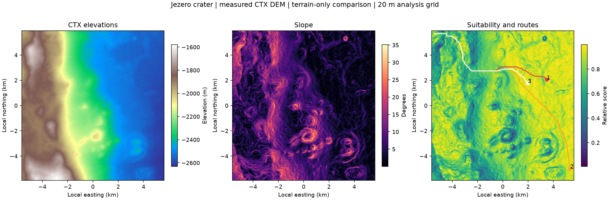

# Jezero terrain comparison

Measured NASA MRO CTX stereo DEM, distributed by USGS.

Illustrative terrain-only candidate cells, not habitat engineering recommendations.

| Rank | Longitude E | Latitude N | Score | Slope (deg) | Roughness (m) | Route (m) | Straight (m) | Terrain cost (m equivalent) |
| --- | --- | --- | --- | --- | --- | --- | --- | --- |
| 1 | 77.41188 | 18.38473 | 0.9994 | 0.036 | 0.061 | 11510.9 | 9623.2 | 27898.5 |
| 2 | 77.44488 | 18.26594 | 0.9993 | 0.021 | 0.084 | 18000.7 | 15174.6 | 35873.3 |
| 3 | 77.38521 | 18.38001 | 0.9992 | 0.018 | 0.095 | 10036.4 | 8383.5 | 25936.6 |

Weights: slope 0.70, roughness 0.30; both lower-is-better, min-max normalized over jointly valid cells.
Roughness: 5x5 population standard deviation (100 m footprint). Traversability: slope <=15 degrees and roughness <=20 m.
A*: eight-connected, no corner cutting, destination-cell cost times step length. No smoothing.
Terrain cost is a heuristic penalty in distance-equivalent units, not rover energy or travel time.
Candidates: highest-scoring cells in the largest traversable component, separated by at least 1.5 km.
One common proposed start near the NW corner; scores are relative to this ROI, not probabilities.
Bilinear reprojection to a 20 m local spherical azimuthal equidistant grid; distances are planar.
GeoJSON stores Mars degrees and requires a planetary-aware viewer; it is not Earth RFC 7946 WGS84.
No ice, geology, soil strength, radiation, dust, power, solar or mission economics are inferred.

